<!--
  Agrici Daniel (AgriciDaniel): AI marketing systems architect and open-source creator.
  Open-source Claude Code skills and Claude Code plugins: AI SEO tools, GEO, Google Ads and Meta ads audits, an AI blog writer and an AI second brain.
  Website: https://agricidaniel.com
  YouTube: https://www.youtube.com/@AgriciDaniel
  LinkedIn: https://linkedin.com/in/daniel-agrici
-->

<picture></picture>

 

**Bonfire menu**

- **Level up**: join <a href="https://www.skool.com/ai-marketing-hub-pro">AI Marketing Hub Pro</a>, 40+ AI workflows, 30+ AI SEO and marketing tools and live calls
- **Attune skills**: install <a href="https://github.com/AgriciDaniel/claude-seo">claude-seo</a>, <a href="https://github.com/AgriciDaniel/claude-ads">claude-ads</a> or <a href="https://github.com/AgriciDaniel/claude-blog">claude-blog</a>
- **Travel**: <a href="https://www.youtube.com/@AgriciDaniel">YouTube</a> or <a href="https://agricidaniel.com">agricidaniel.com</a>
- **Kindle**: star a repo you use, it keeps the fire going

  <b>Agrici Daniel</b> builds open-source <b>Claude Code skills</b> and Claude Code plugins for AI SEO, Google Ads, Meta ads and content. 
  Maker of claude-seo, claude-ads, claude-blog and claude-obsidian. 50K+ GitHub stars. Free and MIT licensed.

<picture></picture>

 
<a href="https://www.skool.com/ai-marketing-hub"></a>

**Join the party.** The free [AI Marketing Hub](https://www.skool.com/ai-marketing-hub) on Skool: 5,900+ members building with Claude Code. Ask questions, share workflows, get help when a skill breaks.

##  About Me

AI marketing systems architect. I build free, open-source Claude Code skills for SEO, paid ads and content. Each one is a ready-made workflow: install it, point it at your site or ad account, and it does the work.

They cover technical SEO, local SEO, keyword research, generative engine optimization (GEO and AEO), LLM SEO and ChatGPT SEO for AI Overviews and AI search. Google Ads and Meta ads audits. Blog posts that rank on Google. An AI second brain in Obsidian. The work an agency bills $5-10K/month for, as open-source code you run yourself.

**claude-seo**, **claude-ads** and **claude-blog** are among the most-starred Claude Code skills on GitHub. I also run the free [AI Marketing Hub](https://www.skool.com/ai-marketing-hub) on Skool (5,900+ members) and [AI Marketing Hub Pro](https://www.skool.com/ai-marketing-hub-pro), where we build AI marketing workflows together.

New to it? Start with my [Claude Code tutorial videos on YouTube](https://www.youtube.com/@AgriciDaniel).

##  Claude Code Skills: Choose Your Class

Pick the one that sounds like you. Each class comes with its skill.

<table>
  <tr>
    <td width="50%" valign="top">
      <a href="https://github.com/AgriciDaniel/claude-seo"></a>
      
<b><a href="https://github.com/AgriciDaniel/claude-seo">claude-seo</a></b>: AI SEO for Claude Code: technical audits, schema, E-E-A-T, local SEO and GEO for AI search.
      

    </td>
    <td width="50%" valign="top">
      <a href="https://github.com/AgriciDaniel/claude-ads"></a>
      
<b><a href="https://github.com/AgriciDaniel/claude-ads">claude-ads</a></b>: Google Ads and Meta ads audits across 12 ad platforms, with scored reports.
      

    </td>
  </tr>
  <tr>
    <td width="50%" valign="top">
      <a href="https://github.com/AgriciDaniel/claude-blog"></a>
      
<b><a href="https://github.com/AgriciDaniel/claude-blog">claude-blog</a></b>: AI blog writer that ranks on Google and gets cited in AI search.
      

    </td>
    <td width="50%" valign="top">
      <a href="https://github.com/AgriciDaniel/claude-obsidian">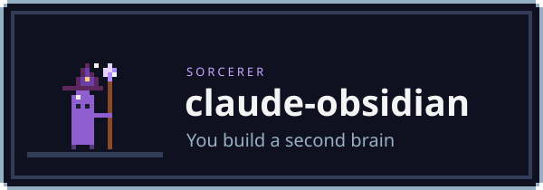</a>
      
<b><a href="https://github.com/AgriciDaniel/claude-obsidian">claude-obsidian</a></b>: AI second brain for Obsidian. Drop in any source, Claude links and files it.
      

    </td>
  </tr>
</table>

<picture></picture>

 

- **[banana-claude](https://github.com/AgriciDaniel/banana-claude)**: AI image generation skill for Claude Code, powered by Gemini.
- **[compass](https://github.com/AgriciDaniel/compass)**: Run your whole life out of Obsidian. Daily questions, planning, habits, tasks and an AI assistant in the vault.
- **[jev-seo](https://github.com/AgriciDaniel/jev-seo)**: Live SEO audit for any website from one homepage URL. PDF, XLSX and Markdown reports.
- **[claude-youtube](https://github.com/AgriciDaniel/claude-youtube)**: YouTube skill for Claude Code. Channel audits, video SEO, retention scripts, thumbnails and Shorts.
- **[youtubepro](https://github.com/AgriciDaniel/youtubepro)**: Local-first YouTube research, script writing and thumbnail creation.
- **[on-page-seo](https://github.com/AgriciDaniel/on-page-seo)**: On-page SEO analyzer for any website.
- **[keywordpro](https://github.com/AgriciDaniel/keywordpro)**: Local-first keyword research tool with guided reports, charts and exports.
- **[claude-cybersecurity](https://github.com/AgriciDaniel/claude-cybersecurity)**: Security code review skill for Claude Code. 8 specialist agents, OWASP, CWE Top 25 and MITRE ATT&CK.
- **[claude-shorts](https://github.com/AgriciDaniel/claude-shorts)**: Turns long videos into Shorts with animated captions, inside Claude Code.

##  Boss Fight

<picture></picture>

 
<a href="https://www.skool.com/ai-marketing-hub-pro"></a>

**The $10K/mo Agency Retainer.** Weakness: open-source skills you run yourself. claude-seo, claude-ads and claude-blog do the audits, the ads checks and the posts. MIT licensed.

**Want the full build?** <a href="https://www.skool.com/ai-marketing-hub-pro"><b>AI Marketing Hub Pro</b></a> has 40+ AI workflows, 30+ AI SEO and marketing tools, and 100+ live calls where we build them together.

##  FAQ

<b>What are Claude Code skills?</b>

 
Folders of instructions, scripts and reference files that Claude Code loads when a task needs them. A plugin bundles skills, agents and commands so you can install them with <code>/plugin install</code>.

<b>Are these Claude Code plugins free?</b>

 
Yes. Every repo here is MIT licensed. Some skills can connect paid data APIs, such as DataForSEO, if you choose to.

<b>Which AI SEO tool should I start with?</b>

 
claude-seo for SEO, GEO and AI search. claude-ads for Google Ads, Meta ads and other ad platforms. claude-blog for blog posts. claude-obsidian for a second brain.

<b>How to rank on Google and in AI search with these skills?</b>

 
Install claude-seo and run <code>/seo audit</code> on your site. It checks technical SEO, schema, content and AI visibility, then lists what to fix for Google, ChatGPT and Perplexity. claude-blog writes the posts.

<b>Where can I learn Claude Code?</b>

 
Step-by-step <a href="https://www.youtube.com/@AgriciDaniel">Claude Code tutorial videos</a> on YouTube, and questions answered in the free <a href="https://www.skool.com/ai-marketing-hub">AI Marketing Hub</a> community on Skool.

##  Tech Stack


##  Connect

  
  
  
  
  

