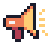

<!--
  Agrici Daniel (AgriciDaniel): AI marketing systems architect and open-source creator.
  Open-source Claude Code skills and Claude Code plugins: AI SEO tools, GEO, Google Ads and Meta ads audits, an AI blog writer and an AI second brain.
  Website: https://agricidaniel.com
  YouTube: https://www.youtube.com/@AgriciDaniel
  LinkedIn: https://linkedin.com/in/daniel-agrici
-->

<a href="https://www.skool.com/ai-marketing-hub-pro"></a>

<p align="center">
  <b>Agrici Daniel</b> builds open-source <b>Claude Code skills</b> and Claude Code plugins for AI SEO, Google Ads, Meta ads and content.<br />
  Maker of claude-seo, claude-ads, claude-blog and claude-obsidian. 50K+ GitHub stars. Free and MIT licensed.
</p>



##  About Me

AI marketing systems architect. I build free AI SEO tools, AI agents and marketing automation that run inside Claude Code. Here's the skill, here's what it does, here's how to install it.

What they cover: technical SEO, local SEO, keyword research, generative engine optimization (GEO and AEO), LLM SEO and ChatGPT SEO for AI Overviews and AI search. Google Ads and Meta ads audits. Blog posts that rank on Google. An AI second brain in Obsidian. The work an agency bills $5-10K/month for, as open-source code you run yourself.

**claude-seo**, **claude-ads** and **claude-blog** are among the most-starred Claude Code skills on GitHub. I also run the free [AI Marketing Hub](https://www.skool.com/ai-marketing-hub) on Skool (5,900+ members) and [AI Marketing Hub Pro](https://www.skool.com/ai-marketing-hub-pro), where we build AI marketing workflows together.

New to it? Start with my [Claude Code tutorial videos on YouTube](https://www.youtube.com/@AgriciDaniel).

##  Claude Code Skills and Plugins

<table>
  <tr>
    <td width="50%" valign="top">
      <a href="https://github.com/AgriciDaniel/claude-seo"></a>
      <p><b><a href="https://github.com/AgriciDaniel/claude-seo">claude-seo</a></b>: AI SEO tool for Claude Code. Technical SEO audits, local SEO, ecommerce SEO, schema markup, E-E-A-T and backlinks, plus GEO for ChatGPT, Perplexity and Google AI Overviews.</p>
      <p>
        <a href="https://github.com/AgriciDaniel/claude-seo"></a>
        <a href="https://github.com/AgriciDaniel/claude-seo/fork"></a>
        <a href="https://agricidaniel.com/blog/claude-code-seo-stack">Claude Code SEO stack deep dive</a>
      </p>
    </td>
    <td width="50%" valign="top">
      <a href="https://github.com/AgriciDaniel/claude-ads"></a>
      <p><b><a href="https://github.com/AgriciDaniel/claude-ads">claude-ads</a></b>: Google Ads audit and Meta ads audit (Facebook ads and Instagram), plus YouTube, LinkedIn, TikTok, Microsoft, Amazon and 5 more. 12 ad platforms, scored reports with sources.</p>
      <p>
        <a href="https://github.com/AgriciDaniel/claude-ads"></a>
        <a href="https://github.com/AgriciDaniel/claude-ads/fork"></a>
        <a href="https://agricidaniel.com/blog/claude-code-ad-agency">claude-ads full breakdown</a>
      </p>
    </td>
  </tr>
  <tr>
    <td width="50%" valign="top">
      <a href="https://github.com/AgriciDaniel/claude-blog"></a>
      <p><b><a href="https://github.com/AgriciDaniel/claude-blog">claude-blog</a></b>: AI blog writer for Claude Code. Writes, rewrites and audits blog posts that rank on Google and get cited in AI search. E-E-A-T, schema and GEO checks built in.</p>
      <p>
        <a href="https://github.com/AgriciDaniel/claude-blog"></a>
        <a href="https://github.com/AgriciDaniel/claude-blog/fork"></a>
        <a href="https://agricidaniel.com/blog/claude-code-blog-writer">Claude Code blog writer walkthrough</a>
      </p>
    </td>
    <td width="50%" valign="top">
      <a href="https://github.com/AgriciDaniel/claude-obsidian"></a>
      <p><b><a href="https://github.com/AgriciDaniel/claude-obsidian">claude-obsidian</a></b>: AI second brain for Obsidian and Claude Code. Drop in any source. Claude reads it, links it and files it into a knowledge graph of plain Markdown you own.</p>
      <p>
        <a href="https://github.com/AgriciDaniel/claude-obsidian"></a>
        <a href="https://github.com/AgriciDaniel/claude-obsidian/fork"></a>
        <a href="https://agricidaniel.com/blog/claude-obsidian-ai-second-brain">Obsidian AI second brain deep dive</a>
      </p>
    </td>
  </tr>
</table>

<details>
<summary><b>More open-source AI marketing tools</b></summary>
<br />

- **[codex-seo](https://github.com/AgriciDaniel/codex-seo)**: Codex-first SEO skill suite. 26 workflows and 24 agents, with DataForSEO, Gemini, Google and Firecrawl integrations.
- **[banana-claude](https://github.com/AgriciDaniel/banana-claude)**: AI image generation skill for Claude Code, powered by Gemini.
- **[jev-seo](https://github.com/AgriciDaniel/jev-seo)**: Live SEO audit for any website from one homepage URL. PDF, XLSX and Markdown reports.
- **[keywordpro](https://github.com/AgriciDaniel/keywordpro)**: Local-first keyword research tool with guided reports, charts and exports.
- **[youtubepro](https://github.com/AgriciDaniel/youtubepro)**: Local-first YouTube research, script writing and thumbnail creation.
- **[claude-email](https://github.com/AgriciDaniel/claude-email)**: Email marketing and inbox management skill for Claude Code.
- **[claude-canvas](https://github.com/AgriciDaniel/claude-canvas)**: AI visual production for Obsidian Canvas: presentations, flowcharts and mood boards.
- **[wp-mcp-ultimate](https://github.com/AgriciDaniel/wp-mcp-ultimate)**: WordPress MCP server with 58 WordPress abilities.
- **[compass](https://github.com/AgriciDaniel/compass)**: Run your whole life out of Obsidian.

</details>

##  Choose Your Class

Pick the one that sounds like you.

<details>
<summary><picture></picture> <b>Knight</b>: you run an SEO agency</summary>
<br />
Audit client sites in minutes. Run <code>/seo audit</code> with <a href="https://github.com/AgriciDaniel/claude-seo">claude-seo</a> for SEO and GEO, and <code>/ads audit all</code> with <a href="https://github.com/AgriciDaniel/claude-ads">claude-ads</a> for paid clients. Both hand you a prioritized report.
</details>

<details>
<summary><picture></picture> <b>Merchant</b>: you own a business</summary>
<br />
Want customers from Google and ChatGPT? Run <code>/seo audit</code> on your site, then <code>/seo local</code> for Google Maps. Fix the top of the list first.
</details>

<details>
<summary><picture></picture> <b>Herald</b>: you are a marketer</summary>
<br />
Content and ads without the busywork. <a href="https://github.com/AgriciDaniel/claude-blog">claude-blog</a> writes posts that rank (<code>/blog write</code>). claude-ads checks your Google Ads and Meta ads.
</details>

<details>
<summary><picture></picture> <b>Sorcerer</b>: you build things</summary>
<br />
Everything here is MIT. Fork it, read how the skills are built, and start an AI second brain with <a href="https://github.com/AgriciDaniel/claude-obsidian">claude-obsidian</a>.
</details>

Every class levels up faster in <a href="https://www.skool.com/ai-marketing-hub-pro"><b>AI Marketing Hub Pro</b></a>: the workflows, the tools and live calls.

##  Install a Claude Code Plugin



Install any flagship skill from inside Claude Code (1.0.33+), then restart:

```text
# SEO
/plugin marketplace add AgriciDaniel/claude-seo
/plugin install claude-seo@agricidaniel-claude-seo

# Paid advertising
/plugin marketplace add AgriciDaniel/claude-ads
/plugin install claude-ads@ai-marketing-hub-claude-ads

# Blog content
/plugin marketplace add AgriciDaniel/claude-blog
/plugin install claude-blog@agricidaniel-blog
```

Everything here is MIT licensed. Manual and Windows installs are documented in each repo.

##  Boss Fight

<details>
<summary><picture></picture></summary>
<br />


**The $10K/mo Agency Retainer.** Weakness: open-source skills you run yourself. claude-seo, claude-ads and claude-blog do the audits, the ads checks and the posts. MIT licensed.

**Want the full build?** <a href="https://www.skool.com/ai-marketing-hub-pro"><b>AI Marketing Hub Pro</b></a> has 40+ AI workflows, 30+ AI SEO and marketing tools, and 100+ live calls where we build them together.

<a href="https://www.skool.com/ai-marketing-hub-pro"></a>
</details>

##  FAQ

<details>
<summary><b>What are Claude Code skills?</b></summary>
<br />
Folders of instructions, scripts and reference files that Claude Code loads when a task needs them. A plugin bundles skills, agents and commands so you can install them with <code>/plugin install</code>.
</details>

<details>
<summary><b>Are these Claude Code plugins free?</b></summary>
<br />
Yes. Every repo here is MIT licensed. Some skills can connect paid data APIs, such as DataForSEO, if you choose to.
</details>

<details>
<summary><b>Which AI SEO tool should I start with?</b></summary>
<br />
claude-seo for SEO, GEO and AI search. claude-ads for Google Ads, Meta ads and other ad platforms. claude-blog for blog posts. claude-obsidian for a second brain.
</details>

<details>
<summary><b>How to rank on Google and in AI search with these skills?</b></summary>
<br />
Install claude-seo and run <code>/seo audit</code> on your site. It checks technical SEO, schema, content and AI visibility, then lists what to fix for Google, ChatGPT and Perplexity. claude-blog writes the posts.
</details>

<details>
<summary><b>Do they work with Codex?</b></summary>
<br />
For SEO, yes: <a href="https://github.com/AgriciDaniel/codex-seo">codex-seo</a> is a Codex-first SEO skill suite.
</details>

<details>
<summary><b>Where can I learn Claude Code?</b></summary>
<br />
Step-by-step <a href="https://www.youtube.com/@AgriciDaniel">Claude Code tutorial videos</a> on YouTube, and questions answered in the free <a href="https://www.skool.com/ai-marketing-hub">AI Marketing Hub</a> community on Skool.
</details>

##  Tech Stack


##  Messages

Messages left on the ground by other travelers. Click to read.

<details>
<summary><picture></picture> <b>Try /seo audit before writing anything</b></summary>
<br />
Fix what is broken first. New content on a site with crawl or schema problems is wasted work.
</details>

<details>
<summary><picture></picture> <b>Hidden path ahead: the free AI Marketing Hub</b></summary>
<br />
5,900+ members building with Claude Code. Ask questions and share workflows in the <a href="https://www.skool.com/ai-marketing-hub">AI Marketing Hub</a> on Skool.
</details>

<details>
<summary><picture></picture> <b>Be wary of tools that promise rankings without showing the system</b></summary>
<br />
Every skill here is open source. Read the code, run it, check the output.
</details>

<details>
<summary><picture></picture> <b>Treasure ahead: Pro</b></summary>
<br />
<a href="https://www.skool.com/ai-marketing-hub-pro">AI Marketing Hub Pro</a> has 40+ AI workflows, 30+ AI SEO and marketing tools, and live calls.
</details>

<a href="https://github.com/AgriciDaniel/AgriciDaniel/issues/new?title=Message%3A%20&body=Leave%20a%20tip%20for%20the%20next%20builder.%0A%0AFormats%3A%20Try%20___%20%2F%20___%20ahead%20%2F%20Be%20wary%20of%20___">Leave a message</a> for the next builder. It opens an issue on this repo.

##  Connect

<p align="center">
  <a href="https://agricidaniel.com"></a>
  <a href="https://linkedin.com/in/daniel-agrici"></a>
  <a href="https://www.youtube.com/@AgriciDaniel"></a>
  <a href="https://www.skool.com/ai-marketing-hub"></a>
  <a href="https://www.skool.com/ai-marketing-hub-pro"></a>
</p>

<details>
<summary><picture></picture></summary>
<br />


**Bonfire menu**

- **Level up**: join <a href="https://www.skool.com/ai-marketing-hub-pro">AI Marketing Hub Pro</a>
- **Attune skills**: install <a href="https://github.com/AgriciDaniel/claude-seo">claude-seo</a>, <a href="https://github.com/AgriciDaniel/claude-ads">claude-ads</a> or <a href="https://github.com/AgriciDaniel/claude-blog">claude-blog</a>
- **Travel**: <a href="https://www.youtube.com/@AgriciDaniel">YouTube</a> or <a href="https://agricidaniel.com">agricidaniel.com</a>
- **Kindle**: star a repo you use, it keeps the fire going
- **Leave a message**: <a href="https://github.com/AgriciDaniel/AgriciDaniel/issues/new?title=Message%3A%20&body=Leave%20a%20tip%20for%20the%20next%20builder.%0A%0AFormats%3A%20Try%20___%20%2F%20___%20ahead%20%2F%20Be%20wary%20of%20___">write a tip</a> for the next traveler
</details>
